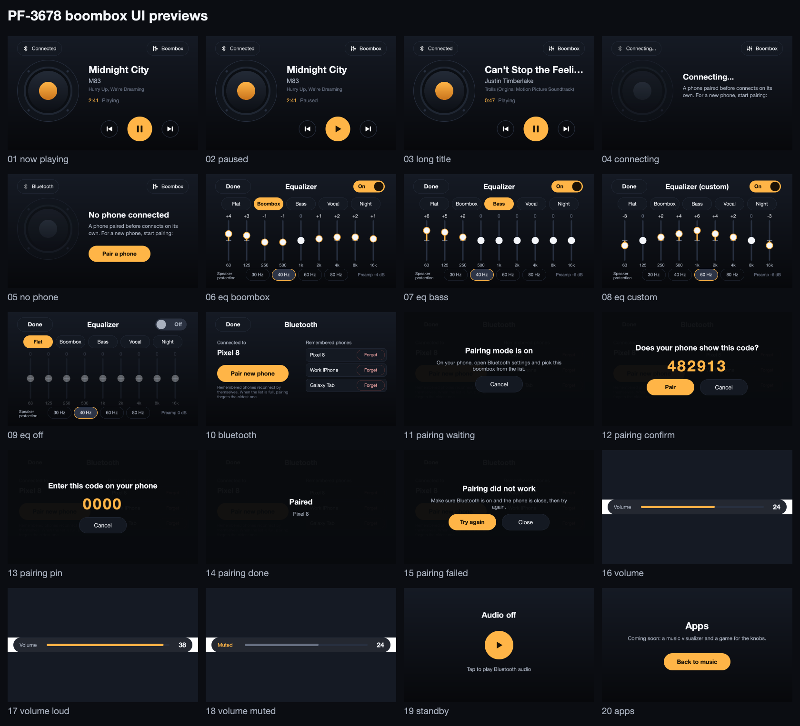

# Clarion PF-3678 boombox mod

Firmware mods for the Clarion PF-3678 head unit (Subaru), turning it into a
Bluetooth-only boombox: a new UI, a software EQ, extra apps, and a faster boot.

The unit runs Linux 2.6.37 from an SD card, with a Qt 4 QML user interface. Everything
here works by editing a copy of the card's image on a computer and flashing it back.
Nothing on the unit is changed in a way that cannot be undone.



## What is in the mod

| Part | What it does |
|---|---|
| **UI** (`ui/`) | Replacement QML screens: now playing, EQ, Bluetooth pairing, volume, standby, apps. |
| **EQ** (`eq/`) | `libbtaeq.so`, hooked into the Bluetooth audio path. 9-band graphic EQ, speaker-protection high-pass, preamp and peak limiter. |
| **Apps** (`apps/`, `wfplay/`) | An apps screen, and a local MP3 player service with its own QML front end. |
| **Boot** (`rootfs/`) | Stops car and media services a boombox does not need, and starts Bluetooth in parallel. |

## Repository layout

```
ui/              our QML; each file replaces the stock file at the same path
apps/            extra QML apps
eq/              EQ library source, host tests, cross-compile script (zig)
wfplay/          MP3 player service (static binary, minimp3)
rootfs/          files installed onto the SYSTEM partition (boot scripts, EQ presets)
rootfs-inplace/  boot scripts rewritten in place, same size as stock
tools/           image builder, Qt 4 resource pack/unpack, string dump, checks
preview/         desktop preview of the UI on Qt 6, with screenshots
install.sh       staged, reversible installer
firmware/        where your own dump of the unit goes (not included, see below)
docs/            how to dump, build, flash and add your own mods
```

## Quick start

1. Dump your unit's SD card: [docs/DUMPING.md](docs/DUMPING.md)
2. Build a modded image and flash it: [docs/BUILDING.md](docs/BUILDING.md)
3. Add your own screens, apps or EQ presets: [docs/MODDING.md](docs/MODDING.md)

```sh
brew install e2fsprogs zig
python3 tools/build_image.py --src firmware/clarion-pf3678-golden.img \
    --stages eq,ui --out build/boombox-eq-ui.img
```

## Firmware

This repository does not contain Clarion's firmware. You need your own dump of the
unit's SD card; [docs/DUMPING.md](docs/DUMPING.md) explains how to take one and lists the
partition layout and the checksum of the dump this mod was developed against.

## Safety

Keep the original dump, and ideally the original SD card, untouched. Flashing the
original dump back returns the unit to stock.
